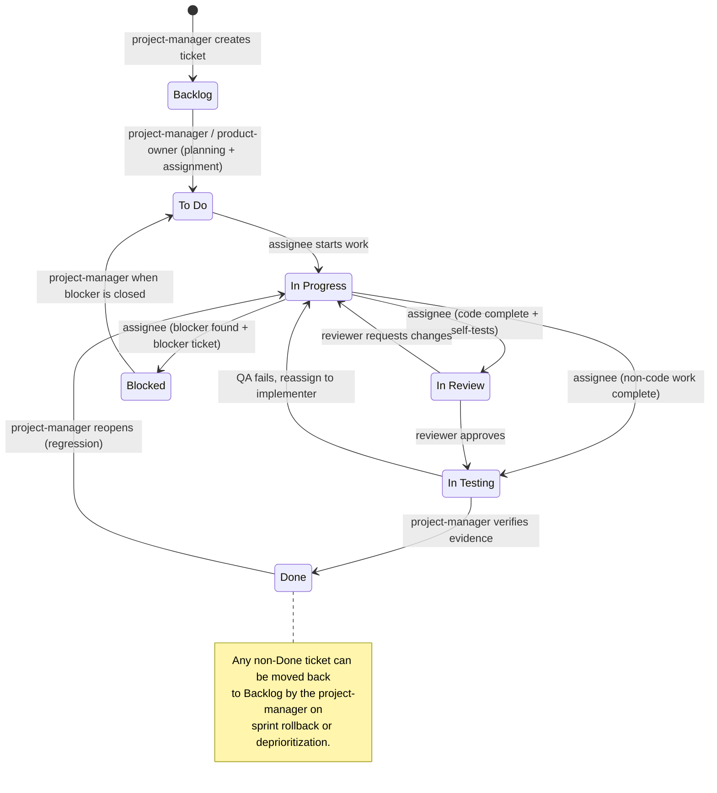
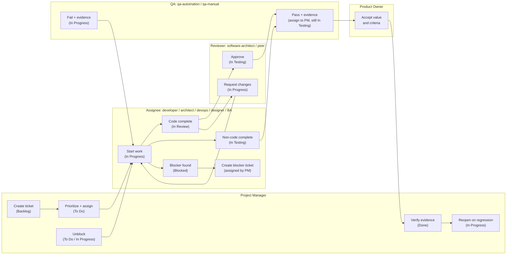
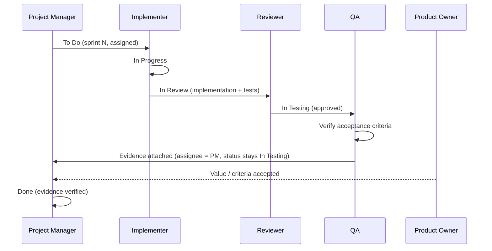
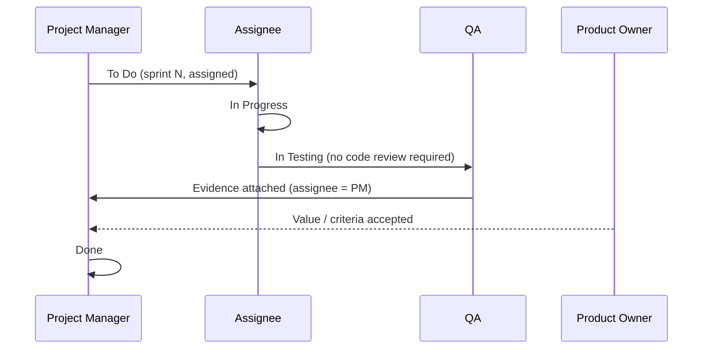
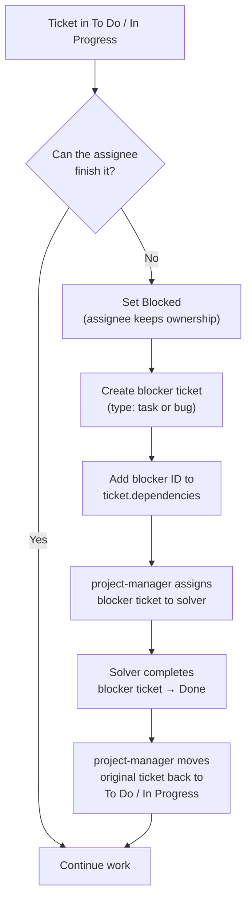

# Ticket Lifecycle & Status Ownership

> Visual reference for validating the state-transition model before it is applied to the
> agent definitions. All transitions happen **inside an active sprint**.

## 1. Canonical statuses and accountable owner

| Status (JSON slug) | Display name | Definition | Accountable owner |
|---|---|---|---|
| `backlog` | Backlog | Created but not prioritized | `project-manager` |
| `to-do` | To Do | Prioritized, sprint-assigned, ready for work | `project-manager` (planning) / assignee (execution) |
| `in-progress` | In Progress | Work started | Current `assignee` |
| `in-review` | In Review | Implementation complete, awaiting code/technical review | Assigned reviewer (default `software-architect`) |
| `in-testing` | In Testing | Verification of acceptance criteria | `qa-automation` / `qa-manual` |
| `blocked` | Blocked | Waiting on a dependency | Current `assignee` + `project-manager` (unblocking) |
| `done` | Done | All criteria met with verified evidence | `project-manager` |

> **Key rule:** only the status owner may change the status. No subagent may set `done`.

## 2. State machine



### ASCII fallback

```text
                         ┌──────────────────────────────┐
                         │ project-manager / PO         │
                         ▼                              │
 [*] ──▶ Backlog ──▶ To Do ──▶ In Progress ──▶ In Review ──▶ In Testing ──▶ Done
             ▲          ▲            │               │             │            │
             │          │            │               │             │            │
             │          │            ▼               ▼             ▼            │
             │          │         Blocked        In Progress   In Progress ◀────┘
             │          │            │          (changes)      (QA failed)
             │          │            │
             │          └────────────┘
             │        blocker closed (PM)
             │
             └──── sprint rollback / deprioritization (PM / PO)
```

## 3. Who does what (swimlane)



### 3.1 Reviewer assignment rule (`In Review`)

When the implementer moves a ticket to `In Review`, it **must reassign it to a reviewer**
different from itself. The selection order is:

1. **Default:** `software-architect`.
2. **If the implementer is `software-architect`:** the most senior peer in the same domain:
   - `backend-developer` for backend/API work
   - `database-expert` for database/schema work
   - `security-expert` for security reviews, vulnerability assessments and hardening
   - `web-developer` for frontend/UI work
   - `devops-engineer` for infrastructure/CI/CD work
3. **If the ticket is test tooling or test framework work:** `qa-automation`.
4. **If no suitable peer exists:** `project-manager` assigns an explicit reviewer before the
   handoff and records it in the ticket.

Hard constraints:

- The reviewer **must not be the implementer**.
- The reviewer owns the ticket while it is in `In Review` and is the only agent allowed to move
  it to `In Testing` (approved) or back to `In Progress` (changes requested).
- On `In Review → In Testing`, the reviewer reassigns to `qa-automation` or `qa-manual`.
- On `In Review → In Progress`, the reviewer reassigns to the **original implementer**.

Recommended ticket fields for traceability:

```json
{
  "assignee": "software-architect",
  "reviewedBy": "software-architect",
  "implementedBy": "backend-developer"
}
```

## 4. Transition matrix (authorization)

| # | From | To | Who may transition | New assignee | Required artifact / gate |
|---|---|---|---|---|---|
| T1 | Backlog | To Do | `project-manager` (with `product-owner`) | Executing agent | Sprint assigned, priority, acceptance criteria, dependencies listed |
| T2 | To Do | In Progress | Current `assignee` | Same | Start note (branch/approach) |
| T3 | In Progress | In Review | Current `assignee` | Reviewer per §3.1 (default `software-architect`) | Implementation + self-tests + commit/PR + evidence |
| T4 | In Progress | In Testing | Current `assignee` | `qa-automation` or `qa-manual` | Only when **no code review** is required; evidence attached |
| T5 | In Progress | Blocked | Current `assignee` | Same (keeps ownership) | Blocker reason + blocker ticket created and linked |
| T6 | In Review | In Testing | Assigned reviewer | `qa-automation` or `qa-manual` | Review approval recorded |
| T7 | In Review | In Progress | Assigned reviewer | Original implementer | Change requests documented |
| T8 | In Testing | Done | **Only `project-manager`** | None | QA pass + product-owner acceptance + acceptance criteria verified with evidence |
| T9 | In Testing | In Progress | QA agent | Original implementer | Failure evidence; optional bug ticket |
| T10 | Blocked | To Do / In Progress | `project-manager` | Original assignee | Blocker ticket is `done` |
| T11 | Any non-Done | Backlog | `project-manager` / `product-owner` | None | Sprint rollback or deprioritization |
| T12 | Done | In Progress | `project-manager` | Original implementer | Regression or invalidated evidence |

## 5. Happy path (code work)



## 6. Happy path (non-code work)



## 7. Blocked flow



## 8. Non-negotiable rules

1. **One owner at a time.** A ticket has exactly one `assignee` per state.
2. **No status change without a history entry.** Every transition updates
   `status`, `assignee`, `updatedAt`, and appends to `statusHistory`.
3. **No skipped states** except `In Progress → In Testing` for non-code work.
4. **Only the project-manager closes tickets.** QA verifies; PM validates evidence and sets `done`.
5. **Blocked keeps ownership.** The original assignee stays responsible; the blocker ticket is
   assigned to the agent that can solve it.
6. **Everything inside the sprint.** Tickets not verified before sprint close are carried over
   (sprint incremented) or returned to Backlog; `done` is never set after sprint close.
7. **A subagent must not modify a ticket it does not own.** It reports the mismatch to the
   project-manager instead.
8. **One transition per ticket per sprint.** In each sprint the assigned agent performs a single
   phase action and the orchestrator applies one status change; the ticket advances sprint by
   sprint until it reaches `done`.
9. **Planning by load.** At sprint start the free capacity is
   `tasks_per_sprint − open tickets` (non-epic `to-do`, `in-progress`, `in-review`,
   `in-testing`, `blocked`). The `project-manager` agent is only invoked when capacity > 0 and
   moves at most that many tickets from `backlog` to `to-do`; extras are returned to backlog.
   If no ticket progresses for `max_stalled_sprints` consecutive sprints (default 3), the run
   aborts.
10. **Only ready tickets occupy the sprint.** A ticket enters the sprint only when all its
    dependencies are `done`. At sprint start, `to-do` tickets with open dependencies are returned
    to backlog so the slot goes to ready work. The `backlog → to-do` history entry is recorded
    by the orchestrator.
11. **The result is the only signal.** Agents write `result` + `resultEvidence`; a status changed
    by an agent without `result` is reverted. Supported results include `completed`, `blocked`,
    `changes-requested`, `failed`, `passed`, `passed-with-skips`, `skipped-unsupported-platform`, and `done`.
    If acceptance criteria cannot be executed due to host platform limitations (e.g., Apple Safari on Linux),
    QA documents them in `resultEvidence` as `skipped-unsupported-platform` and reports `passed` / `passed-with-skips`
    for the executable criteria rather than blocking the ticket. If the session ends without `result`,
    the agent is asked once more in the same session before the phase counts as not completed.
12. **Conditional unblocking and retry bounds.** A blocked ticket is unblocked by the orchestrator
    (`blocked → to-do`) only when all its dependencies are closed, and (for tickets without dependencies)
    when other tickets have completed since it was blocked, up to `max_retries_per_ticket` (default 3).
    Transitions to `blocked` and unblock operations do not count as forward progress towards resetting
    `max_stalled_sprints`, preventing infinite unblock loops.
13. **Compacted status history.** To prevent unbounded growth of ticket JSON files and avoid token context
    exhaustion across multi-sprint workflows, `statusHistory` is automatically trimmed to the last $N$
    transitions (`max_status_history`, default 10). Critical lifecycle counters (such as `blockedRetryCount`)
    are persisted independently on the ticket to guarantee consistency.

## 9. Status update example

```json
{
  "status": "in-review",
  "assignee": "software-architect",
  "updatedAt": "2026-10-23T15:30:00Z",
  "statusHistory": [
    {
      "from": "in-progress",
      "to": "in-review",
      "actor": "backend-developer",
      "timestamp": "2026-10-23T15:30:00Z",
      "reason": "Implementation complete; unit tests passing",
      "evidence": ["commit:abc123", "test-report:unit-20261023"]
    }
  ]
}
```

## 10. Points to confirm before applying

- [ ] **In Review is required** for code changes. Confirm whether you prefer the simpler
      `In Progress → In Testing` for all work (as in the original example) or keep review.
- [ ] **QA hands off to the PM while status stays `In Testing`.** If you want an explicit
      `In Acceptance` state, it must be added to the canonical status list.
- [ ] **Done authority:** ticket-level closure belongs to `project-manager`; `product-manager`
      only approves at epic/release level. Confirm if you want `product-owner` to also close.
- [ ] **Blocked ownership:** the original assignee remains the owner while blocked. Confirm
      whether the blocker solver should become the assignee instead.
